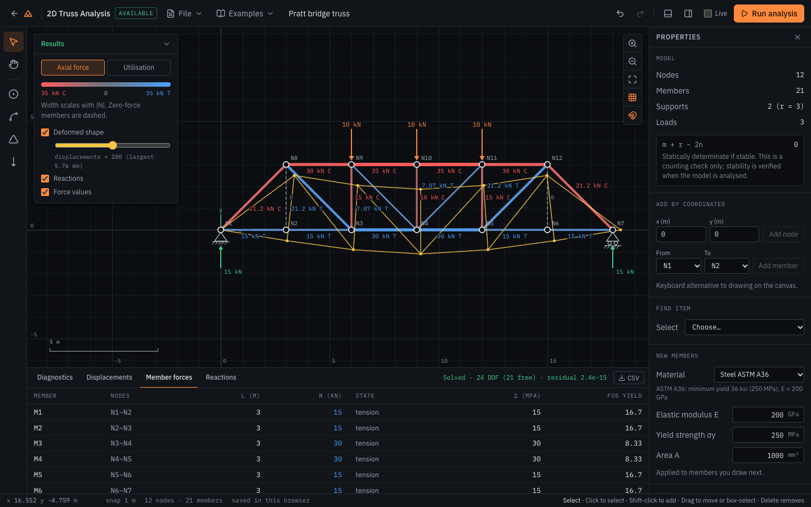
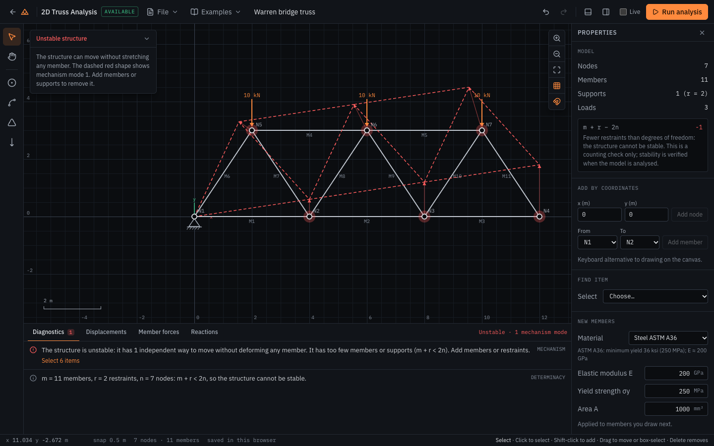

# SimForge

**The open-source engineering playground.** Browser-based mechanical engineering
simulation built on real numerical methods, with documented assumptions. Everything
runs locally in the browser: no servers, accounts or API keys.

<!-- Live site and CI badge: add once the GitHub repository is published. -->



The first simulator is a **2D truss analyser**. Build a truss (or open one of seven
examples), run the solver, and inspect member forces, stresses, displacements, support
reactions and factors of safety. Save the model as a file, or export results to CSV
and images.

> **Status: v0.1.0-dev.** The truss simulator is complete and validated. Other
> simulators are on the [roadmap](#roadmap).

## How the solver works

A linear elastic, pin-jointed plane truss analysis by the **direct stiffness method**:

1. Element stiffness, `kₑ = (EA/L) [C −C; −C C]` with `C = [c² cs; cs s²]`
2. Assembly of the global stiffness matrix `K`
3. Partitioning into free and restrained degrees of freedom, including support
   settlements: `K_ff u_f = F_f − K_fs u_s`
4. Solution by LDLᵀ (Cholesky) factorisation. The stiffness matrix is never inverted.
   `K_ff` is positive definite exactly when the structure is stable, so a vanishing
   pivot identifies a mechanism, and the solver also returns its mode shape.
5. Post-processing:
   - member axial forces `N = (EA/L)[−c −s c s] uₑ`
   - stresses `σ = N/A`
   - support reactions
   - an independent nodal equilibrium check

All quantities are SI internally (m, N, m², Pa). The formulation, sign conventions,
diagnostics and validation evidence are in [docs/METHODOLOGY.md](docs/METHODOLOGY.md).

### Validation

- **Hand-derived reference cases.** The solver is tested against eleven of them, to a
  relative tolerance of 10⁻⁹:
  - two-bar and three-bar trusses
  - an indeterminate hanger, with and without support settlement
  - Warren, Pratt, Howe roof and cantilever trusses
  - bars in series

  Every case is also checked for equilibrium and energy balance (Clapeyron's theorem).
- **Property tests:** invariance under rotation and renumbering, superposition, and
  mechanism detection.
- **Browser tests:** they build a reference truss through the UI and check that the
  rendered tables match the hand solution.
- **Independent cross-check:** `scripts/crosscheck_truss.py` solves any saved model with
  a separate Python implementation and compares the result with SimForge's CSV export.

### Assumptions and limitations

- Members carry axial force only (no bending or shear); joints are frictionless pins.
- Linear elastic material, small displacements.
- **Buckling is not checked.** The factor of safety is against yielding only, and
  compression members must be checked for buckling separately.
- No fatigue, plasticity or dynamics. Loads are applied at nodes only.



## Using the workspace

Open it from the homepage with **Launch simulator**, or choose an entry from the
**Examples** menu. Inputs are in m, kN, GPa and mm², and stored in SI.

| Key | Action |
| --- | --- |
| `V` | Select: click, Shift-click, drag a box; drag items to move them |
| `H` / Space (hold) / middle mouse | Pan |
| `N` | Add node (snaps to the grid; hold Alt to place freely) |
| `M` | Add member: click node to node, or click empty space to add a node |
| `S` | Add support: click a node; click again to cycle pin → roller (y) → roller (x) → none |
| `F` | Add a 10 kN load to a node; edit it in the properties panel |
| `R` | Run analysis (tick **Live** to re-solve after every edit) |
| Delete / Backspace | Delete the selection (a node takes its members, support and load with it) |
| Arrow keys | Nudge selected nodes by one snap step (Shift: ×10) |
| ⌘/Ctrl+Z, ⇧⌘Z / Ctrl+Y | Undo, redo |
| ⌘/Ctrl+A | Select all |
| ⌘/Ctrl+S, ⌘/Ctrl+O | Save project file, open project file |
| Scroll, `+` / `−`, `0` | Zoom, fit view |
| `G`, `L` | Toggle grid, labels |

Nodes and members can also be added from the keyboard, by coordinates, in the
properties panel.

**What you get after running:**

- **Canvas:**
  - members coloured by axial force (blue tension, red compression, width ∝ |N|,
    zero-force members dashed) or by utilisation |σ|/σy
  - force or factor-of-safety labels and reaction arrows
  - the deformed shape, with adjustable magnification
- **Unstable structures:** the free motion is drawn, and the affected nodes are highlighted.
- **Tables:** displacements, member forces (N, σ, yield FoS) and reactions with
  equilibrium totals, each exportable as CSV.
- **Out-of-date results:** results belong to the model they were computed from. After
  an edit they are marked out of date instead of being shown for the wrong model.

**Saving:**

- The model is kept in your browser automatically.
- **File → Save project** downloads a `.simforge.json` file
  ([format](docs/FILE_FORMAT.md)). Open one with **File → Open** or by dropping it on
  the window.
- **File → Export image** produces a PNG or a standalone SVG.

## Running locally

Requires [Node.js](https://nodejs.org/) 20.19 or newer (the project uses Node 24; see `.nvmrc`).

```bash
npm install       # install dependencies
npm run dev       # dev server: open http://localhost:5173/simforge/
```

| Command | Purpose |
| --- | --- |
| `npm run dev` | Development server with hot reload |
| `npm run build` | Type-check and build the production site into `dist/` |
| `npm run preview` | Serve the production build at http://localhost:4173/simforge/ |
| `npm run test` | Unit and validation tests (Vitest) |
| `npm run typecheck` | TypeScript strict-mode check |
| `npm run test:e2e` | Build, then run the browser tests (Playwright, using your installed Google Chrome) |
| `npm run screenshots` | Regenerate the README images in `docs/images` |

## Project structure

```
src/
  app/            routing, site config, pages
  components/     shared UI (layout, canvas, inputs, menus)
  hooks/          shared React hooks
  modules/
    registry.ts   catalogue of simulators and their status
    structural/
      models/     truss input and result types, material presets
      solver/     direct stiffness solver and input validation
      validation/ analytical reference cases and validation tests
      editor/     editor state (reducer, undo/redo) and canvas geometry
      results/    result indexing, colour scales, factor of safety, CSV
      examples/   example projects built from the validation cases
      project/    project file format and browser autosave
      components/ truss workspace UI
  styles/         Tailwind theme and global styles
  utils/          framework-free helpers (viewport, linear algebra, units)
e2e/              browser tests (Playwright) including accessibility checks
scripts/          development tools (independent Python cross-check)
docs/             methodology, file format, development checklist
```

Engineering calculations live in framework-free TypeScript modules, separate from
React components, so they can be tested directly. A new simulator gets its own folder
under `src/modules/` and an entry in `registry.ts`.

## Deployment

GitHub Actions builds and tests every push. Pushes to `main` are published to GitHub
Pages, at `https://ub-netizen.github.io/simforge/`:

- **ci.yml** runs on pull requests and other branches.
- **deploy.yml** runs on `main`: lockfile install, typecheck, tests, build, browser
  tests, deploy.

The Vite base path is `/simforge/`. The app uses hash routing
(`/simforge/#/structural/truss`) so that direct links and page refreshes work on a
static host.

## Roadmap

| Module | Status |
| --- | --- |
| 2D truss analysis | Available |
| Beam analysis | Planned |
| Interactive fluid flow | Planned |
| Mechanism kinematics (four-bar, slider-crank, gears) | Planned |
| Airfoil aerodynamics | Planned |

Possible next steps for the truss module: buckling checks (section properties and
effective lengths), inclined and spring supports, and load cases. The development
history is in [docs/CHECKLIST.md](docs/CHECKLIST.md) and [CHANGELOG.md](CHANGELOG.md).

## Contributing

Contributions are welcome, especially validation cases with hand-derived solutions.
Read [CONTRIBUTING.md](CONTRIBUTING.md) to get started. Everyone taking part is
expected to follow the [Code of Conduct](CODE_OF_CONDUCT.md).

## License

[MIT](LICENSE)
